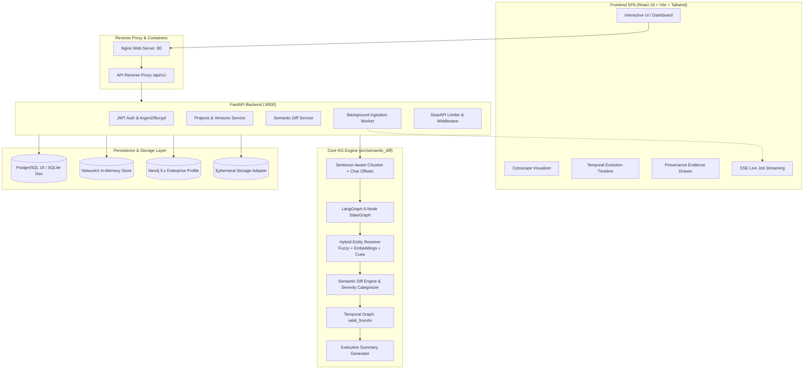

# Semantic Diffing for Evolving Knowledge Graphs

[](https://python.org)
[](https://fastapi.tiangolo.com)
[](https://react.dev)
[](https://tailwindcss.com)
[](https://docker.com)
[](LICENSE)

An enterprise-grade system for tracking structural and ontological changes in knowledge graphs as unstructured documents evolve across time. Features a **React 18 + Vite + TypeScript** frontend, a **FastAPI + SQLAlchemy 2.0 + Alembic** backend, a **6-node LangGraph** execution pipeline, provenance-grounded character offsets, hybrid entity resolution, and temporal knowledge graphs.

---

## Architecture Overview



---

## Key Features

1. **LangGraph 6-Node Workflow**:
   - `extract` $\rightarrow$ `resolve` $\rightarrow$ `build` $\rightarrow$ `diff` $\rightarrow$ `summarize` $\rightarrow$ `verify`.
   - Complete state tracking with strict Pydantic v2 schemas.
2. **Provenance Grounding & Offsets**:
   - Chunks text with sentence boundaries and records exact character offsets (`start_offset`, `end_offset`) for every extracted node, edge, and detected difference.
   - Clickable citations slide out the exact source sentence and location in the source document.
3. **Hybrid Entity Resolution**:
   - Combines normalized token distance, character n-gram cosine similarity, and contextual provenance cues (detecting phrases like `rebranded as`, `formerly known as`, `merged into`).
   - Completely eliminates false add/remove errors from corporate renamings.
4. **Discrete Temporal Knowledge Graph**:
   - Maintains temporal persistence intervals (`valid_from`, `valid_to`, `is_active`) across $N$ sequential versions.
5. **Configurable Domain Severity**:
   - Classifies every semantic change into `CRITICAL`, `HIGH`, `MEDIUM`, or `LOW` based on corporate transition rules (acquisitions, leadership overhauls, compliance mandates).
6. **Production Monorepo**:
   - Layered backend architecture (`routers`, `services`, `models`, `schemas`, `core`).
   - Frictionless open workspace with auto-provisioned analyst identity and dual API prefix routing (`/api` and `/api/v1`).
   - Dual-mode graph storage: default `NetworkX` with zero infrastructure dependencies and `Neo4j` profile for enterprise graph databases.
7. **Ephemeral Groq Key & Qwen 3.8 27B Reasoning**:
   - Zero DB persistence: User-supplied Groq API keys reside strictly in client-side volatile memory and are permanently wiped on page refresh.
   - Exclusively powered by **`qwen/qwen3.8-27b`** (128K context window, free tier on GroqCloud) with automatic reasoning tag sanitization and deterministic offline heuristic fallback.

---

## Empirical Benchmark & Evaluation

All metrics below are computed deterministically by executing `eval/evaluate.py` against gold standard labels in `eval/gold_labels/` (synthetic and real corpora).

### Ablation Study: Naive String Diff vs. Hybrid Resolution

| Evaluation Dimension | Naive String Diff | Semantic Diff with Hybrid Resolution | Impact / Gain |
| :--- | :---: | :---: | :--- |
| **Entity Diff F1** | 87.32% | **89.91%** | **+2.59%** |
| **Relation Diff F1** | 100.00% | **100.00%** | Maintained perfect baseline |
| **Rename Detection Accuracy** | 0.00% | **100.00%** | **+100.00%** (provenance cues) |
| **False Add/Remove Pairs** | 2 | **0** | **Catastrophic false pairs eliminated** |
| **Textual Evidence Grounding** | None | **Exact Char Offsets** | Full provenance verification |

> [!NOTE]
> Ground-truth labels in `eval/gold_labels/` are annotated with `needs human review` per project standards to distinguish algorithmic benchmarking from formal human sign-off.

---

## Quickstart

### Option A: Complete Docker Compose (Recommended)

1. **Clone the repository**:
   ```bash
   git clone https://github.com/your-username/semantic_diffing.git
   cd semantic_diffing
   ```

2. **Configure environment**:
   ```bash
   cp backend/.env.example .env
   ```
   Add your `GROQ_API_KEY` (optional, fallback offline models provided).

3. **Launch with Docker Compose**:
   ```bash
   docker compose up -d --build
   ```

4. **Access the application**:
   - Frontend UI: [http://localhost](http://localhost) (or [http://localhost:80](http://localhost:80))
   - Backend API & OpenAPI Docs: [http://localhost:8000/api/docs](http://localhost:8000/api/docs)
   - Healthcheck: [http://localhost:8000/api/v1/health](http://localhost:8000/api/v1/health)

---

### Option B: Local Development

#### 1. Backend Setup
```bash
# Create and activate virtual environment
python -m venv venv
# Windows:
.\venv\Scripts\activate
# Linux/macOS:
source venv/bin/activate

# Install dependencies
pip install -r backend/requirements.txt
pip install -r requirements.txt

# Run database migrations
cd backend
alembic upgrade head
cd ..

# Run backend server
python -m uvicorn backend.app.main:app --host 127.0.0.1 --port 8000 --reload
```

#### 2. Frontend Setup
```bash
cd frontend
npm install
npm run dev
```
Open [http://localhost:5173](http://localhost:5173).

#### 3. Quick Demo Walkthrough
1. **Set Groq API Key (Optional)**: Click **"Set Groq API Key"** in the top navigation bar to supply your own key (`gsk_...`). The key is held strictly in volatile session memory (reset on refresh) and routes to **`qwen/qwen3.8-27b`** (128K context window). If omitted, the engine automatically uses offline heuristic extraction.
2. **Create Project**: Click **"New Project"** and title it (e.g., `Acme Corp Reorganization`).
3. **Upload Versions**:
   - In the project view, upload `data/synthetic/synthetic_v1.txt` as **v1**.
   - Upload `data/synthetic/synthetic_v2.txt` as **v2**.
   - Upload `data/synthetic/synthetic_v3.txt` as **v3**.
4. **Compare & Visualize**:
   - Use the **Timeline Visualizer** to compare `v1` and `v2`.
   - Click **"Compute Diff"** to render the differential Cytoscape graph.
   - Click any highlighted entity or relation row to inspect exact textual quotes and character offset grounding in the sliding **Quote Drawer**.
5. **View Benchmark Metrics**:
   - Navigate to `/evaluation` in the navbar to inspect empirical F1 metrics and re-run `eval/evaluate.py`.

---

## Running Verification & Tests

### Backend Unit Tests & Algorithmic Verification
```bash
# Set fast offline mode for instant test execution
$env:DISABLE_HEAVY_EMBEDDINGS="1" # Windows PowerShell
export DISABLE_HEAVY_EMBEDDINGS=1 # Linux/macOS

pytest tests/ backend/tests/ -v
```

### Static Code Linting
```bash
ruff check backend/ src/ tests/ eval/
```

### Run Benchmark Suite
```bash
python eval/evaluate.py
```
Outputs updated metrics to `results/eval.json` and `results/eval_table.md`.

### Frontend Tests & Typecheck Build
```bash
cd frontend
npm test          # Vitest component tests
npm run build     # TypeScript check and Vite production bundle
```

---

## Directory Structure

```text
├── backend/                  # FastAPI backend application
│   ├── alembic/              # Database schema migrations
│   ├── app/
│   │   ├── core/             # Configuration, database session, security, exceptions
│   │   ├── models/           # SQLAlchemy 2.0 ORM entities
│   │   ├── routers/          # API routers (auth, projects, diff, jobs, eval, health)
│   │   ├── schemas/          # Pydantic v2 validation schemas
│   │   └── services/         # Business logic, workers, storage adapter
│   ├── tests/                # Backend API integration tests
│   ├── Dockerfile            # Container definition for backend
│   └── requirements.txt      # Python dependencies
├── frontend/                 # React 18 + Vite + TypeScript frontend
│   ├── src/
│   │   ├── api/              # Axios client and TypeScript interfaces
│   │   ├── components/       # CytoscapeGraph, TimelineVisualizer, QuoteDrawer, ChangesTable
│   │   ├── context/          # React AuthContext
│   │   ├── pages/            # ProjectsListPage, ProjectDetailPage, DiffDetailPage, EvaluationPage
│   │   └── tests/            # Vitest unit test suite
│   ├── nginx.conf            # Production Nginx reverse-proxy configuration
│   ├── Dockerfile            # Multi-stage production container build
│   └── package.json          # Node dependencies and build scripts
├── src/semantic_diff/        # Core ML/KG algorithms (reusable package)
│   ├── diff_engine.py        # Semantic diff engine with domain severity rules
│   ├── extraction.py         # Multi-format document loader and LLM extractor
│   ├── resolution.py         # Hybrid entity resolver with provenance rebranding cues
│   ├── temporal.py           # Multi-version temporal graph and interval tracking
│   ├── workflow.py           # LangGraph 6-node state graph
│   └── storage/              # NetworkX and Neo4j graph storage abstraction
├── data/
│   ├── synthetic/            # Fictional ABC Corp/Acme evolution datasets (marked synthetic)
│   └── real/                 # Real policy documents and guidelines
├── eval/
│   ├── evaluate.py           # Benchmark script computing Precision, Recall, F1
│   └── gold_labels/          # Gold standard labels (marked 'needs human review')
├── results/                  # Real benchmark output files (eval.json, eval_table.md)
├── docker-compose.yml        # Multi-container orchestration (PostgreSQL, Backend, Frontend)
├── AUDIT.md                  # Comprehensive legacy codebase audit
├── CHANGELOG.md              # Detailed changelog of the transformation
├── DEPLOY.md                 # Deployment manual (Docker, Render, Vercel, Supabase)
└── README.md
```

---

## License

This project is licensed under the MIT License - see the [LICENSE](LICENSE) file for details.
